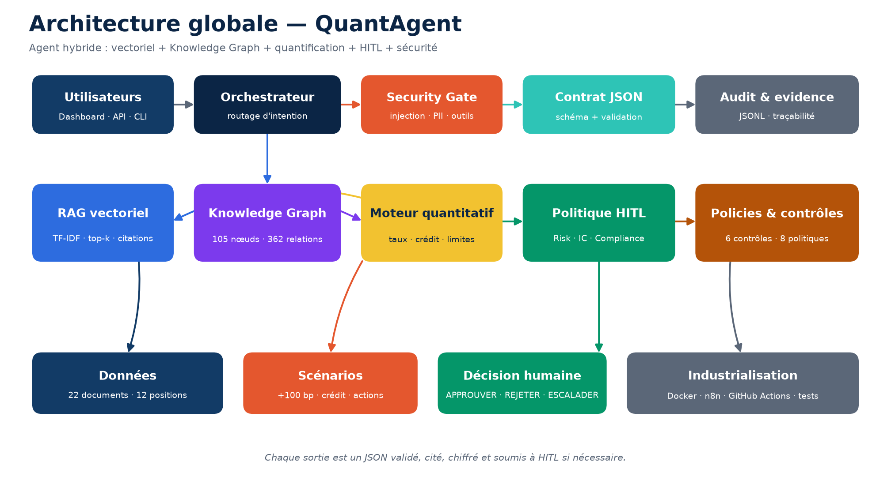
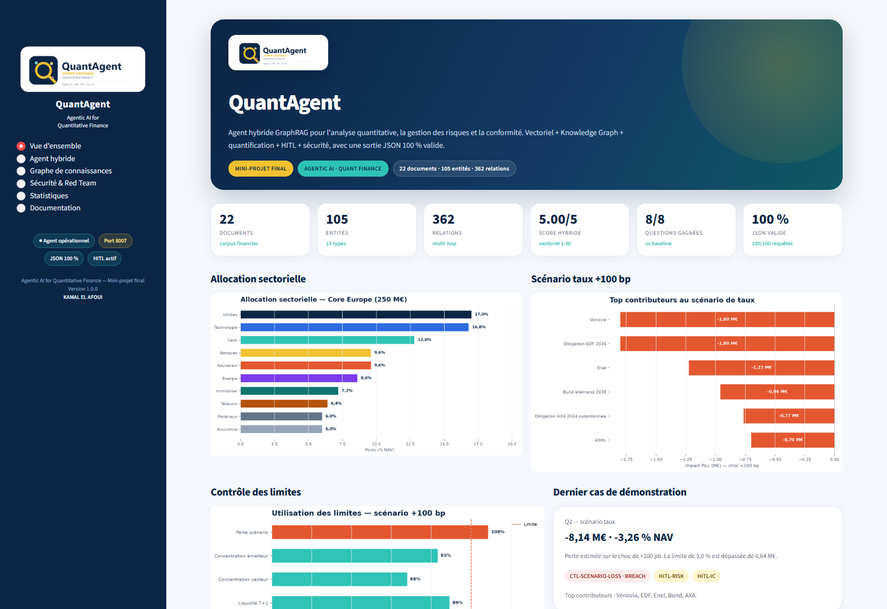
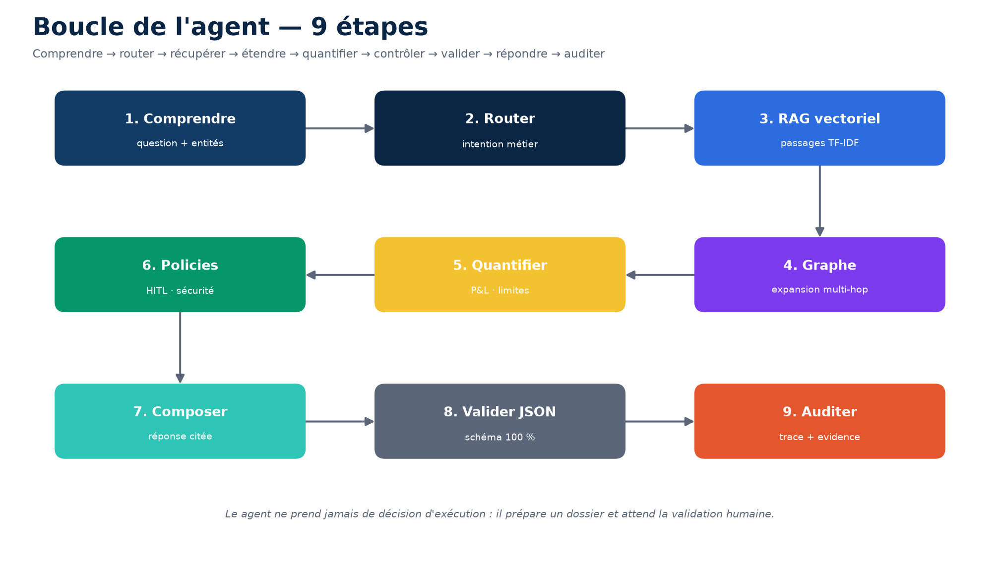
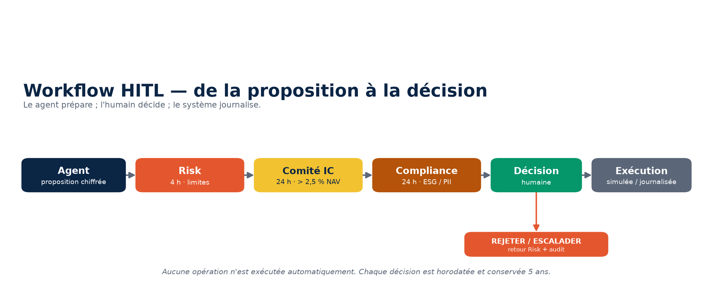
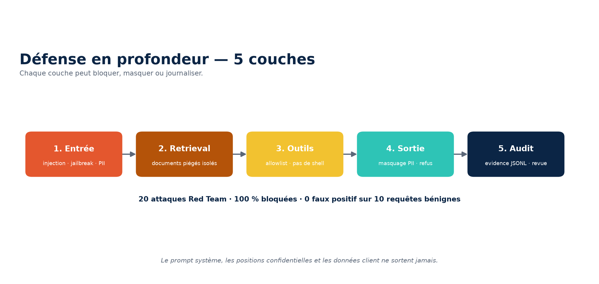

# QuantAgent — Agentic AI for Quantitative Finance

**Agent hybride GraphRAG pour l'analyse quantitative, la gestion des risques et la conformité.**

[](https://www.python.org/)
[](http://localhost:8007)
[](results/validation_report.json)
[](results/red_team.json)
[](tests/)
[](LICENSE)


> **Mini-projet final — Agentic AI for Quantitative Finance**  
> Centre des TPE Solidaires · APDA Technology · Novembre 2026  
> Auteur : **KAMAL EL AFOUI**

---

## En une phrase

QuantAgent répond à des questions financières **multi-hop** en combinant une recherche vectorielle TF-IDF, un **Knowledge Graph** de 105 entités et 362 relations, un **moteur quantitatif** de scénarios, des **garde-fous de sécurité** et une **validation humaine HITL** — avec une sortie **JSON 100 % valide**.

## Résultats clés

| Indicateur | Valeur |
|---|---:|
| Documents financiers | **22** |
| Positions du portefeuille | **12** |
| NAV du portefeuille Core Europe | **250 M€** |
| Entités du graphe | **105** |
| Relations du graphe | **362** |
| Questions d'évaluation | **8** |
| Score agent hybride | **5,00 / 5** |
| Score baseline vectorielle | **1,90 / 5** |
| Questions gagnées | **8 / 8** |
| JSON valide | **100 / 100** |
| Attaques Red Team bloquées | **20 / 20** |
| Faux positifs | **0 / 10** |
| Latence médiane | **< 300 ms** (local) |

**Cas de démonstration** : choc de **+100 pb** sur les taux EUR. L'agent calcule une perte de **-8,14 M€**, soit **-3,26 % NAV**, identifie Vonovia, EDF, Enel, le Bund et AXA comme principaux contributeurs, constate le dépassement de la limite de **3,0 %** et prépare un dossier **HITL-RISK + HITL-IC**.



---

## Démarrage rapide

```bash
# 1. Environnement
python -m venv .venv
.venv\Scripts\activate              # Windows
# source .venv/bin/activate         # macOS / Linux
pip install -r requirements.txt

# 2. Pipeline complet : évaluation + Red Team + JSON + visuels
python main.py demo

# 3. Dashboard — http://localhost:8007
python main.py serve

# 4. API — http://localhost:8000/docs
python main.py api

# 5. Poser une question en CLI
python main.py ask "Quel est l'impact d'un choc de +100 pb sur les taux EUR ?"
python main.py ask "..." --mode vector --json
```

## Dashboard — `localhost:8007`

Le dashboard Streamlit contient :

- **logo** et identité visuelle QuantAgent ;
- **menu** latéral : Vue d'ensemble, Agent hybride, Graphe, Sécurité, Statistiques, Documentation ;
- **formulaire** : question, portefeuille, scénario, mode (hybride / vectoriel / graph) ;
- **graphiques** : allocation sectorielle, contributeurs au scénario, utilisation des limites, comparaison vectoriel vs hybride, Red Team ;
- **statistiques** : KPI, scores, JSON, HITL, tableau par question ;
- **journal HITL** : approuver / rejeter / escalader une proposition (mode simulation) ;
- **téléchargements** : JSON, documentation, présentation, notebook.



## Le cas d'usage multi-hop

**Question de référence Q2** :

> *Quel est l'impact estimé d'un choc de +100 pb sur les taux EUR pour le portefeuille Core Europe, et quelles positions contribuent le plus ?*

Le raisonnement traverse plusieurs sauts :

```text
PF-CORE-EU
  └── HOLDS → POS-03 Vonovia ── SENSITIVE_TO → FACTOR-EUR-RATES
  └── HOLDS → POS-08 EDF 2035 ── SENSITIVE_TO → FACTOR-EUR-RATES
  └── HOLDS → POS-04 Enel ────── SENSITIVE_TO → FACTOR-EUR-RATES
  └── HOLDS → POS-11 Bund ────── SENSITIVE_TO → FACTOR-EUR-RATES
  └── HOLDS → POS-10 AXA 2034 ── SENSITIVE_TO → FACTOR-CREDIT-SPREAD
  └── CONSTRAINED_BY → CTL-SCENARIO-LOSS
  └── GOVERNED_BY → POL-HITL → HITL-RISK / HITL-IC
```

Le graphe fournit les **chemins de preuve** ; le moteur quantitatif fournit les **chiffres** ; la politique HITL fournit le **statut de décision**.

## Architecture

| Couche | Rôle | Fichier |
|---|---|---|
| Sécurité | filtre injection, PII, outils, conseil | `quantagent/security.py` |
| Routage | intention métier et scénario | `quantagent/agent.py` |
| Vectoriel | TF-IDF documents + phrases | `quantagent/vector_store.py` |
| Graphe | NetworkX, parcours multi-hop, Cypher | `quantagent/knowledge_graph.py` |
| Quantitatif | P&L taux, crédit, actions, limites | `quantagent/quant.py` |
| HITL | politique et journal de décision | `quantagent/hitl.py` |
| Contrat JSON | schéma Draft 2020-12 | `data/response.schema.json` |
| Dashboard | Streamlit port 8007 | `app.py` |
| API | FastAPI `/ask`, `/stats`, `/graph` | `api.py` |
| Workflow | n8n FINAL | `workflows/QuantAgent_n8n_FINAL.json` |



## HITL — Human in the Loop

Le agent **ne prend jamais de décision d'exécution**. Il prépare un dossier et attend une validation humaine.

| Situation | Approbation | Délai |
|---|---|---:|
| Dépassement de limite / impact > 2,5 % NAV | `HITL-RISK` | 4 h |
| Opération de portefeuille > 2,5 % NAV | `HITL-IC` | 24 h |
| Communication client / ESG / PII | `HITL-COMPLIANCE` | 24 h |
| Changement de modèle | `HITL-MODEL` | 48 h |



Chaque décision est journalisée dans `results/hitl_decisions.jsonl` avec reviewer, timestamp, décision et justification. Le mode est explicitement **SIMULATION**.

## Sécurité & Red Team

Défense en profondeur :

1. **Entrée** : injection de prompt, jailbreak, PII, exfiltration ;
2. **Retrieval** : documents piégés isolés dans `data/attack_pack/` ;
3. **Outils** : allowlist, pas de shell, pas de suppression de logs ;
4. **Sortie** : masquage PII, refus, validation JSON ;
5. **Audit** : `results/red_team_evidence.jsonl`.

**Campagne** : 20 attaques (injection, jailbreak, exfiltration, abus d'outils, ingénierie sociale, conseil financier, contenus nuisibles, poisoning) — **20/20 bloquées**, **0 faux positif** sur 10 requêtes bénignes.



## Évaluation

Protocole 0-5 sur 8 questions :

- **Q1** — simple : duration et VaR ;
- **Q2** — multi-hop : scénario taux +100 pb et contributeurs ;
- **Q3** — multi-hop : contrôle des limites après choc ;
- **Q4** — multi-hop : circuit HITL pour une réduction obligataire ;
- **Q5** — intersection : sensibilité taux × vigilance ESG ;
- **Q6** — multi-hop : scénario crédit +50 pb ;
- **Q7** — policy : données personnelles et PII ;
- **Q8** — red-team : injection / exfiltration.

Métriques : pertinence, exactitude, traçabilité, multi-hop, score global.

```text
Vectoriel TF-IDF : 1,90 / 5
QuantAgent       : 5,00 / 5
Delta            : +3,10
Questions gagnées: 8 / 8
JSON valide      : 100 / 100
```

Rapport complet : [`results/rapport_comparatif.md`](results/rapport_comparatif.md).

## Docker

```bash
# Dashboard 8007 + API 8000
docker compose up --build

# Ajouter n8n (profil workflow)
docker compose --profile workflow up -d

# Arrêter
docker compose down
```

- Dashboard : http://localhost:8007
- API : http://localhost:8000/docs
- n8n : http://localhost:5678

## Workflow n8n

`workflows/QuantAgent_n8n_FINAL.json` :

```text
Webhook POST /webhook/quantagent
  → validation d'entrée
  → appel API /ask
  → validation du contrat JSON
  → 403 si sécurité bloquée
  → 202 si HITL requis
  → 200 sinon
```

Voir [`workflows/README.md`](workflows/README.md).

## Notebook

`notebooks/QuantAgent_Agentic_AI_Quantitative_Finance.ipynb` — pipeline reproductible :

1. chargement du corpus et du graphe ;
2. statistiques ;
3. scénario taux +100 bp ;
4. réponse JSON Q2 ;
5. comparaison vectoriel vs hybride ;
6. Red Team ;
7. validation 100/100.

## Documentation et présentation

| Livrable | Fichier |
|---|---|
| Documentation DOCX | `docs/Documentation_Agentic_AI_Quantitative_Finance.docx` |
| Documentation PDF | `docs/Documentation_Agentic_AI_Quantitative_Finance.pdf` |
| Présentation PPTX | `docs/Presentation_Agentic_AI_Quantitative_Finance.pptx` |
| Présentation PDF | `docs/Presentation_Agentic_AI_Quantitative_Finance.pdf` |
| JSON final | `results/JSON_Final.json` |
| Contrat JSON | `data/response.schema.json` |
| Workflow n8n | `workflows/QuantAgent_n8n_FINAL.json` |
| Archive ZIP | `Agentic_AI_Quantitative_Finance_FINAL.zip` |

## Structure

```text
Agentic_AI_Quantitative_Finance/
├── app.py                         # dashboard Streamlit 8007
├── api.py                         # API FastAPI
├── main.py                        # CLI
├── Dockerfile
├── docker-compose.yml
├── requirements.txt
├── data/
│   ├── corpus.json                # 22 documents
│   ├── nodes.json                 # 105 entités
│   ├── edges.json                 # 362 relations
│   ├── questions.json             # 8 questions
│   ├── portfolio.json             # 12 positions
│   ├── scenarios.json             # 3 scénarios
│   ├── response.schema.json       # contrat JSON
│   └── attack_pack/               # 5 documents piégés isolés
├── quantagent/
│   ├── agent.py
│   ├── corpus.py
│   ├── vector_store.py
│   ├── knowledge_graph.py
│   ├── quant.py
│   ├── security.py
│   ├── hitl.py
│   ├── evaluation.py
│   ├── redteam.py
│   ├── schema.py
│   └── visuals.py
├── notebooks/
├── workflows/
├── results/
├── docs/
├── assets/
├── scripts/
└── tests/
```

## Tests

```bash
pytest -q
```

Tests couverts : chargement du corpus, graphe, scénario, JSON Schema, sécurité, HITL, comparaison.

## GitHub

Dépôt : `https://github.com/kamalelafoui/agentic-ai-quantitative-finance`

```bash
git clone https://github.com/kamalelafoui/agentic-ai-quantitative-finance.git
cd agentic-ai-quantitative-finance
python main.py demo
python main.py serve
```

## Avertissement

QuantAgent est un **outil de recherche et de démonstration pédagogique**. Les données sont **fictives**. Les sorties ne constituent **ni un conseil en investissement, ni une recommandation personnalisée, ni une exécution d'ordre**. Toute décision reste soumise à validation humaine.

## Licence

MIT — voir [`LICENSE`](LICENSE).
